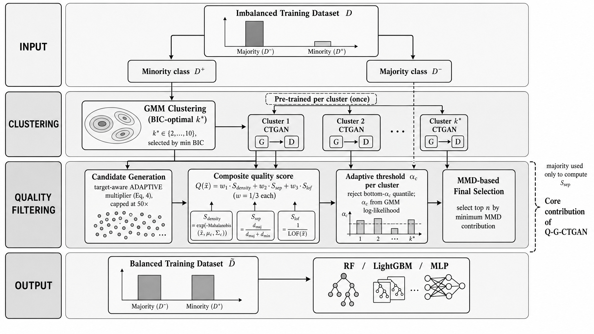

# Quality-Aware Cluster-Conditioned Oversampling via Intra-Cluster Synthetic Sample Filtering

Reproducibility code and results for **Q-G-CTGAN**, accepted for publication in
*Applied Soft Computing* (manuscript ASOC-D-26-06410R2, accepted 6 November 2026).

> M. Yang, *Quality-Aware Cluster-Conditioned Oversampling via Intra-Cluster
> Synthetic Sample Filtering*, Applied Soft Computing (2026), accepted.

Q-G-CTGAN addresses class imbalance in tabular classification. The minority class
is partitioned into sub-clusters with a Gaussian Mixture Model (GMM), a separate
CTGAN is trained on each sub-cluster, and the generated candidates pass a
**two-stage quality filter**:

1. **Stage 1 — composite quality score** `Q(x)`, combining density fidelity,
   boundary separability and local-outlier behaviour, with an adaptive
   per-cluster rejection quantile `α_c`;
2. **Stage 2 — MMD-based selection**, which keeps the candidates that best align
   the retained set with the real minority distribution.

Q-G-CTGAN extends **G-CTGAN** (GMM + per-cluster CTGAN, no filter):

> M. Yang, Oversampling method combining Gaussian mixture model and CTGAN for
> imbalanced data classification, *Journal of the Korea Institute of Information
> and Communication Engineering* 30(5) (2026) 825–836.



---

## Repository layout

```
.
├── data/                                   # place the 16 dataset CSVs here (see Data availability)
├── notebooks/
│   ├── qgctgan_core.py                     # Q-G-CTGAN / G-CTGAN implementation (GMM, per-cluster CTGAN, two-stage filter)
│   ├── 01_run_baselines_classic.ipynb      # None, SMOTE, ADASYN, G-SMOTE
│   ├── 02_run_baselines_ctgan.ipynb        # K-means CTGAN, CTGAN-MOS
│   ├── 03_run_qgctgan_and_gctgan.ipynb     # Q-G-CTGAN (proposed) + G-CTGAN (unfiltered); logs MMD² per run
│   ├── 04_run_ctdgan.ipynb                 # ctdGAN
│   ├── 05_run_ctabgan.ipynb                # CTAB-GAN+
│   ├── 06_aggregate_and_statistics.ipynb   # mean/std/95% CI, per-classifier Friedman–Nemenyi, full vs. unfiltered
│   ├── 07_figures.ipynb                    # CD diagrams, mean-CI plots, box plots, full-vs-unfiltered plots
│   ├── 08_run_ablations.ipynb              # multi-seed ablation of the filter (components / threshold / MMD stage)
│   ├── 09_ablation_tables.ipynb            # marginal ablation summaries (alpha sensitivity, Table A.21)
│   ├── r3_reanalysis.py                    # final-version analyses: per-cell CIs, CI of averages,
│   │                                       #   paired ablation differences, MMD² summary + Figure 8
│   └── r3_tsne_seed42.py                   # Figures 9–10: t-SNE of one identified run (split seed 42)
├── requirements/                           # one requirements file per environment (see Environments)
├── results/
│   ├── tables/                             # all CSV outputs (raw per-seed, aggregated, statistics)
│   └── figures/                            # all figures (.png / .pdf)
└── fig01–fig03_*.png                       # method illustrations (manuscript Figures 1–3)
```

Each notebook is a **single self-contained code cell** (English comments; notebook
name on the first line), so it can be run top-to-bottom in whichever environment
its method requires. The two `r3_*.py` scripts are plain Python and are run from
the `notebooks/` directory.

---

## Data availability

Place each dataset as `data/<name>.csv` with a `target` column (`1` = minority /
positive class). Dataset files are not redistributed here. All 16 datasets are
public:

- **UCI Machine Learning Repository** (https://archive.ics.uci.edu): Pima
  Diabetes, Credit Default, IBM HR Attrition, Ecoli, Wine Quality, Yeast ME2,
  Mammography, Abalone 19, PageBlocks, Protein Homology, and SECOM
  (https://archive.ics.uci.edu/dataset/179; missing values median-imputed,
  `class`/`timestamp` and zero-variance columns dropped).
- **OpenML** (https://www.openml.org): Satellite (Statlog/Landsat, data ID 182),
  Churn (data ID 40701), PageBlocks (data ID 30).
- **Kaggle**: Fraud Detection (`mlg-ulb/creditcardfraud`); UNSW-NB15
  (`dhoogla/unswnb15`, training-set parquet), a mirror of the original release
  by UNSW Canberra (https://research.unsw.edu.au/projects/unsw-nb15-dataset).
- **imbalanced-learn** `fetch_datasets()`: Thyroid Sick, and several of the above.

Expected keys (16): `credit_default, fraud_detection, pima_diabetes,
ibm_attrition, yeast_me2, mammography, abalone_19, wine_quality, ecoli,
pageblocks, protein_homo, satellite, churn, secom, thyroid_sick, unsw_nb15`.

---

## Environments

The generative baselines use mutually incompatible dependencies; use one
environment per notebook (Python 3.10+ recommended). Package lists are in
`requirements/`.

| Notebook / script | Requirements file | Key packages |
|---|---|---|
| 01 | `env_classic.txt` | `scikit-learn`, `imbalanced-learn`, `imbalanced-learn-extra` (`imblearn_extra`), `lightgbm` |
| 02, 03, 08, `r3_tsne_seed42.py` | `env_ctgan.txt` | `scikit-learn`, `ctgan`, `torch`, `lightgbm`, `scipy` |
| 04 | `env_ctdgan.txt` | `artsyn==0.5.2` (ctdGAN), `scikit-learn`, `lightgbm`, `torch` |
| 05 | `env_ctabgan.txt` | CTAB-GAN+ repository (`Team-TUD/CTAB-GAN-Plus`) on `sys.path`, `torch`, `scikit-learn`, `lightgbm` |
| 06, 07, 09, `r3_reanalysis.py` | `env_analysis.txt` | `pandas`, `numpy`, `scipy`, `scikit-posthocs`, `matplotlib`, `seaborn` |

For notebook 05, clone the CTAB-GAN+ repository and set `CTABGAN_REPO` (top of the
cell) to its path.

---

## How to run

1. Put the 16 CSVs in `data/`.
2. Run notebooks **01–05**, each in its matching environment. Each writes a
   `results/tables/raw_<family>.csv`. To test quickly, set `DATASETS_SUBSET`
   (e.g. `["ecoli", "pima_diabetes"]`) and/or shorten `SEEDS` at the top of the cell.
3. Run **06** to merge the raw files and produce the aggregated tables and
   statistics, then **07** for the figures.
4. Run **08** (ablation runs) and **09** (marginal ablation summaries).
5. From `notebooks/`, run `python r3_reanalysis.py` (no new experiments; reads the
   CSVs above and the logged output of notebook 03) and, in the ctgan environment
   with `data/pima_diabetes.csv` and `data/yeast_me2.csv` present,
   `python r3_tsne_seed42.py`.

Steps 3–5 need no GPU and run in seconds to minutes; all their inputs are already
committed in `results/tables/`, so the reported numbers can be checked without
re-running steps 1–2.

---

## Evaluation protocol

- **Five repeated stratified 70/30 holdouts** (`SEEDS = [42, 43, 44, 45, 46]`);
  features standardised on the training split only; oversampling applied to the
  scaled training set; metrics on the held-out test set.
- **Exceptions to five seeds** (computational cost; marked in every results table
  of the paper): ctdGAN uses a **single seed (42)** on `fraud_detection`,
  `protein_homo` and `unsw_nb15` (1.7–3.6 h per run); CTAB-GAN+ uses **three
  seeds (42–44)** on `thyroid_sick` and is evaluated on **12 of 16** datasets
  (it excludes `fraud_detection`, `protein_homo`, `unsw_nb15` for runtime and
  `ecoli` for near-zero minority yield). Every other (method, dataset) cell,
  including all Q-G-CTGAN and G-CTGAN cells, uses all five seeds.
- Three classifiers: Random Forest, LightGBM, MLP. Metrics: AUC, PR-AUC, macro-F1,
  macro-Precision, macro-Recall, G-mean, Balanced Accuracy.
- **Uncertainty.** Per (dataset, method) cell: mean over the available seeds with a
  95% CI (Student-*t*, df = *n* − 1). Average over datasets: the average is
  computed separately for each seed and the 95% CI is taken over the five per-seed
  averages (df = 4); a cell with fewer than five seeds enters every per-seed
  average with its available-seed mean.
- **Statistics.** A separate Friedman test per classifier, with Nemenyi post-hoc
  and critical-difference diagrams, on the across-seed mean AUC.
- **Q-G-CTGAN vs. G-CTGAN (unfiltered).** Both share the same generative base per
  (dataset, seed); G-CTGAN draws uniformly at random from the candidate pool with
  no filter, isolating the contribution of the two-stage filter.
- **Ablation.** Every variant reuses the identical generative base per (dataset,
  seed) and changes only the filter configuration. Each design choice is assessed
  by its **paired** difference to the simpler alternative, separately per
  classifier: within-pair difference, averaged over seeds per dataset, then mean
  and 95% CI over the 16 datasets, Wilcoxon signed-rank test with Holm adjustment
  over the seven comparisons, and win/tie/loss counts.
- **Distribution quality.** MMD² (biased estimate, RBF kernel, median-heuristic
  bandwidth, standardised features) between the real training-split minority
  samples and the synthetic samples, before filtering (entire candidate pool) and
  after filtering (samples added to the training set), logged for every
  Q-G-CTGAN run in notebook 03 and summarised as five-run means with 95% CIs.

---

## Where each result in the paper comes from

Table and figure numbers refer to the published (final) version.

| Paper | File(s) in `results/` | Produced by |
|---|---|---|
| Tables 4–6 (AUC per classifier, mean ± CI) | `tables/r3_cell_mean_ci.csv`, `tables/table_auc_mean_ci_*.csv` | `r3_reanalysis.py`, 06 |
| Table 7 (average AUC with CI over seeds) | `tables/r3_average_ci.csv` | `r3_reanalysis.py` |
| Tables 8–9, Figures 5–7 (Friedman, ranks, CD diagrams) | `tables/friedman_summary.csv`, `tables/avg_ranks_*.csv`, `tables/nemenyi_*.csv`, `figures/fig_cd_*` | 06, 07 |
| Table 10, Table A.27 (Q-G-CTGAN vs. G-CTGAN) | `tables/r8_2_full_vs_unfiltered.csv`, `tables/r8_2_per_dataset_detail.csv` | 06 |
| Table 11, Tables A.22–A.23 (paired ablation) | `tables/r3_ablation_paired.csv` (from `tables/raw_ablation.csv`) | 08, `r3_reanalysis.py` |
| Table 12, Figure 8 (MMD² before/after filtering) | `tables/r3_mmd_per_seed.csv`, `tables/r3_mmd_summary.csv`, `figures/fig_r3_mmd_summary.png` | 03, `r3_reanalysis.py` |
| Figures 9–10 (t-SNE, single run, split seed 42) | `figures/fig_r3_tsne_pima_diabetes_seed42.png`, `figures/fig_r3_tsne_yeast_me2_seed42.png` | `r3_tsne_seed42.py` |
| Tables 13 and 15 (runtime) | `generation_time`, `train_time` columns of `tables/05_multiseed_raw.csv` | 01–05 |
| Table A.16, Tables A.24–A.26 (F1, PR-AUC, G-mean, balanced accuracy) | `tables/r3_cell_mean_ci.csv`, `tables/05_aggregated_mean_std_ci.csv` | `r3_reanalysis.py`, 06 |
| Table A.21 (α sensitivity) | `tables/ablation_alpha.csv` | 09 |

**Reproducibility note.** CTGAN training is not bit-wise reproducible across
hardware and library versions even with fixed seeds. Re-running notebooks 02–05
or 08, or `r3_tsne_seed42.py`, can therefore give values that differ slightly
from the committed results (for the seed-42 Pima Diabetes run, MMD² differs in
the fourth decimal place; the Yeast ME2 run agrees to four decimals). The
committed CSVs are the results reported in the paper.

---

## Citation

If you use this code, please cite:

```bibtex
@article{yang2026qgctgan,
  author  = {Yang, Munil},
  title   = {Quality-Aware Cluster-Conditioned Oversampling via Intra-Cluster Synthetic Sample Filtering},
  journal = {Applied Soft Computing},
  year    = {2026},
  note    = {Accepted for publication}
}

@article{yang2026gctgan,
  author  = {Yang, Munil},
  title   = {Oversampling Method Combining {G}aussian Mixture Model and {CTGAN} for Imbalanced Data Classification},
  journal = {Journal of the Korea Institute of Information and Communication Engineering},
  volume  = {30},
  number  = {5},
  pages   = {825--836},
  year    = {2026}
}
```

## License

MIT License — see [`LICENSE`](LICENSE).
